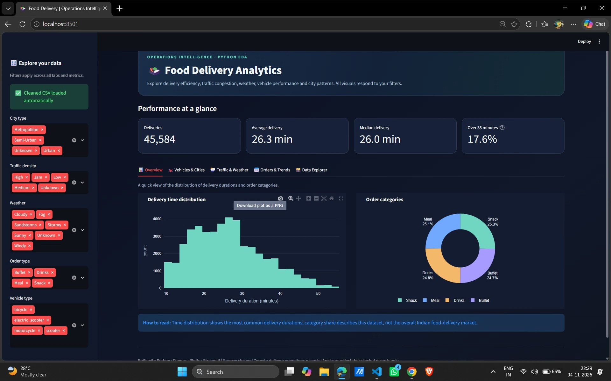
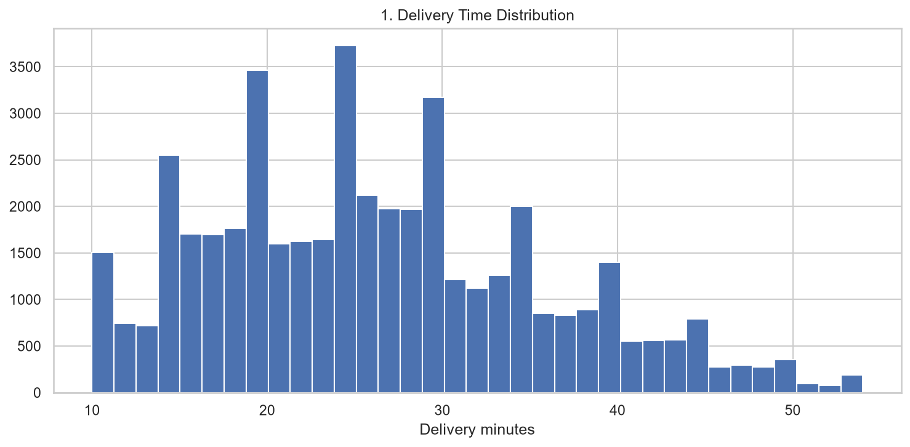
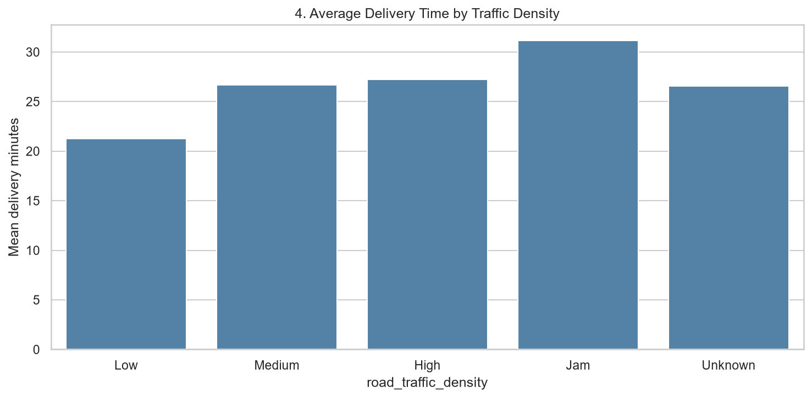
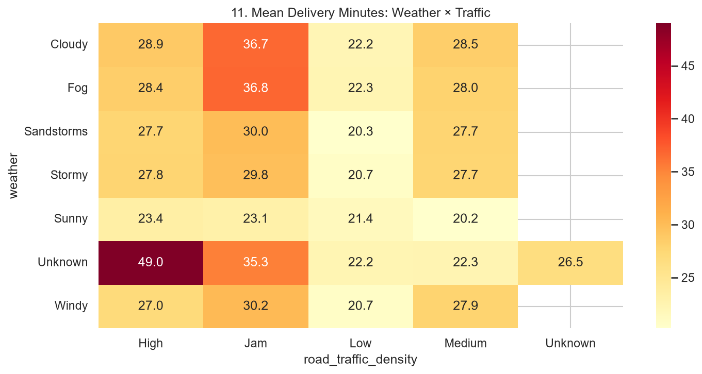

# Food Delivery Analytics

Python exploratory data analysis and an interactive Streamlit dashboard for understanding delivery duration, traffic, weather, vehicles, and geographical patterns across **45,584 food-delivery records**.

## Project overview

This academic big data project turns raw delivery-operation records into a cleaned dataset, 15 reproducible charts, summary metrics, and an interactive dashboard. It uses Pandas for local analysis; the implementation does not use distributed processing such as Spark or Hadoop.

The analysis asks how delivery durations vary with traffic, weather, vehicle type, order category, distance, and time of day.

## Key results

Verified from the supplied `food_delivery_cleaned.csv`:

| Metric | Result |
| --- | ---: |
| Delivery records | 45,584 |
| Date range | 11 February - 6 April 2022 |
| Average delivery duration | 26.29 minutes |
| Median delivery duration | 26 minutes |
| 90th percentile duration | 40 minutes |
| Deliveries over 35 minutes | 17.56% |
| Unique courier IDs | 1,320 |
| Records with usable straight-line distance | 41,513 |

Traffic categories show different delivery durations: **Jam averages 31.18 minutes**, compared with **21.27 minutes for Low traffic**. Straight-line distance has a Pearson correlation of approximately **0.321** with delivery duration among complete records. These are descriptive associations.

## Output previews

### Dashboard overview

An original project screenshot shows delivery KPIs, sidebar filters, the duration distribution, and order categories.



### Delivery duration

The histogram shows the distribution of delivery times across the cleaned records.



### Traffic and delivery duration

Average delivery time varies across the recorded traffic categories.



### Weather and traffic

The heatmap compares mean delivery minutes for combinations of weather and traffic conditions.



**[View all 15 charts with descriptions](eda_charts/README.md)** · **[View project screenshots](docs/screenshots/README.md)**

The original [dashboard PDF](dashboard.pdf) is a historical export of the earlier dashboard design in `dashboard_old.py`; the current `dashboard.py` has an updated interface. The [project photo PDF](photos.pdf) contains the original development screenshots.

## Dashboard features

- Five tabs: Overview, Vehicles & Cities, Traffic & Weather, Orders & Trends, and Data Explorer.
- Filters for city type, traffic, weather, order category, and vehicle type across the five tabs.
- Delivery count, average and median duration, and share exceeding 35 minutes.
- Interactive charts, a 500-row data preview, and export of all filtered records.
- A separate performance classification: Fast (<=20 minutes), Moderate (>20 to 35), and Delayed (>35).
- A geographical map with selectable restaurant pickup and customer delivery points, sampling up to 3,500 points per layer.

The separate performance classification and map load the full local cleaned CSV independently of the sidebar filters. Keep that CSV beside `dashboard.py` to enable all sections. The map restricts coordinates to an approximate India bounding box and shows points rather than driving routes.

## Run locally

Use Python 3.12, matching the checked local environment. From the repository root:

```powershell
python -m venv .venv
.\.venv\Scripts\python.exe -m pip install -r requirements.txt
.\.venv\Scripts\python.exe -m streamlit run dashboard.py
```

Open the local URL printed by Streamlit, usually `http://localhost:8501`. The included cleaned CSV loads automatically. The upper dashboard also supports uploading a cleaned CSV when no local one is present; the two additional sections require the local file.

On macOS or Linux, use `.venv/bin/python` in place of `.\.venv\Scripts\python.exe`.

### Reproduce the EDA

```powershell
.\.venv\Scripts\python.exe -m pip install -r requirements-notebook.txt
.\.venv\Scripts\python.exe -m jupyter lab
```

Open `Food_Delivery_EDA_Corrected.ipynb`, select the project environment, and run every cell in order with the repository root as the working directory. Keep `train.csv` beside the notebook. This regenerates `food_delivery_cleaned.csv`, `eda_summary.csv`, and the 15 PNG files in `eda_charts/`.

VS Code users can install its Python and Jupyter extensions, open the same notebook, and select `.venv` as the kernel.

## Analysis workflow

1. Inspect the source dataset (45,584 rows and 20 columns).
2. Standardize column names, trim text, normalize missing values, parse numeric/date/time fields, and label missing categories as `Unknown`.
3. Remove duplicate order IDs and retain delivery durations between 1 and 240 minutes.
4. Derive order hour, weekday, month, order-to-pickup clock time, delivery bands, and Haversine straight-line distance.
5. Summarize operations and create 15 EDA charts.
6. Export the cleaned dataset for the Streamlit dashboard.

Distance calculations exclude zero or invalid coordinates and distances above 100 km. Pickup clock-time differences account for midnight rollover. Unavailable numeric measurements remain missing.

## Repository contents

| File / folder | Purpose |
| --- | --- |
| `dashboard.py` | Current interactive Streamlit dashboard |
| `dashboard_old.py` | Earlier dashboard version, retained for reference |
| `Food_Delivery_EDA_Corrected.ipynb` | Cleaning, feature engineering, metrics, and chart generation |
| `train.csv` | Supplied raw dataset |
| `food_delivery_cleaned.csv` | Supplied cleaned dataset used by the dashboard |
| `eda_summary.csv` | Saved KPI summary |
| `eda_charts/` | 15 saved chart images and a captioned gallery |
| `docs/screenshots/` | Screenshots extracted from the supplied photo PDF |
| `dashboard.pdf` / `photos.pdf` | Original project evidence |
| `requirements.txt` | Analysis and dashboard dependencies |
| `requirements-notebook.txt` | Additional notebook dependencies |

## Dataset and interpretation

The original project README identifies the source as the Kaggle [Zomato Delivery Operations Analytics Dataset](https://www.kaggle.com/datasets/saurabhbadole/zomato-delivery-operations-analytics-dataset). CSV files supplied with this project are included for reproducibility; their original ownership and terms apply.

Courier ratings are not restaurant ratings. The dataset has no restaurant names, restaurant revenue, menu prices, or restaurant-level profits. City type is a classification. Duration bands are project-defined analytical thresholds. The records are historical and should not be treated as current market demand or evidence of causal effects.

## Technology

Python · Pandas · NumPy · Matplotlib · Seaborn · Plotly · Streamlit · Jupyter
