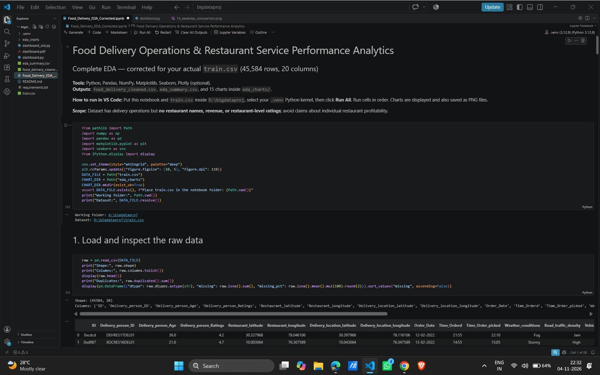
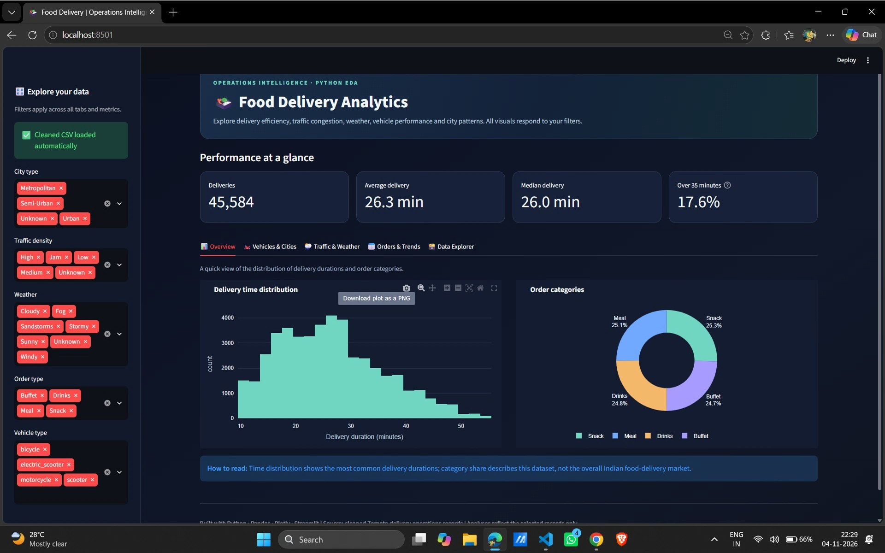
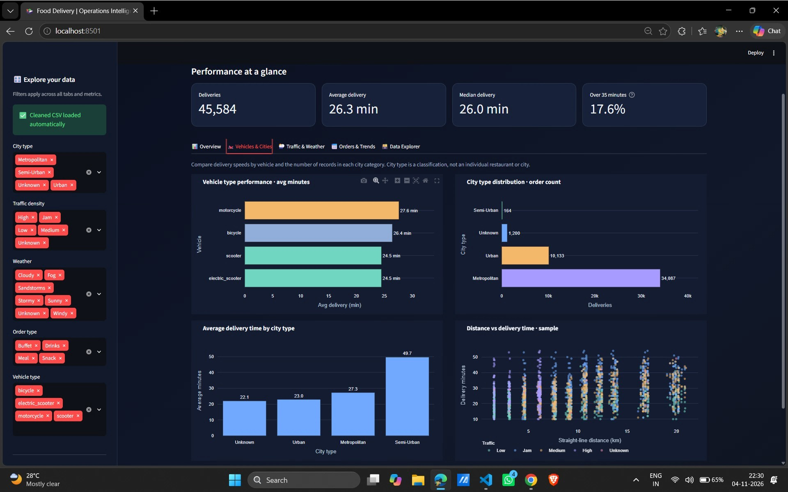
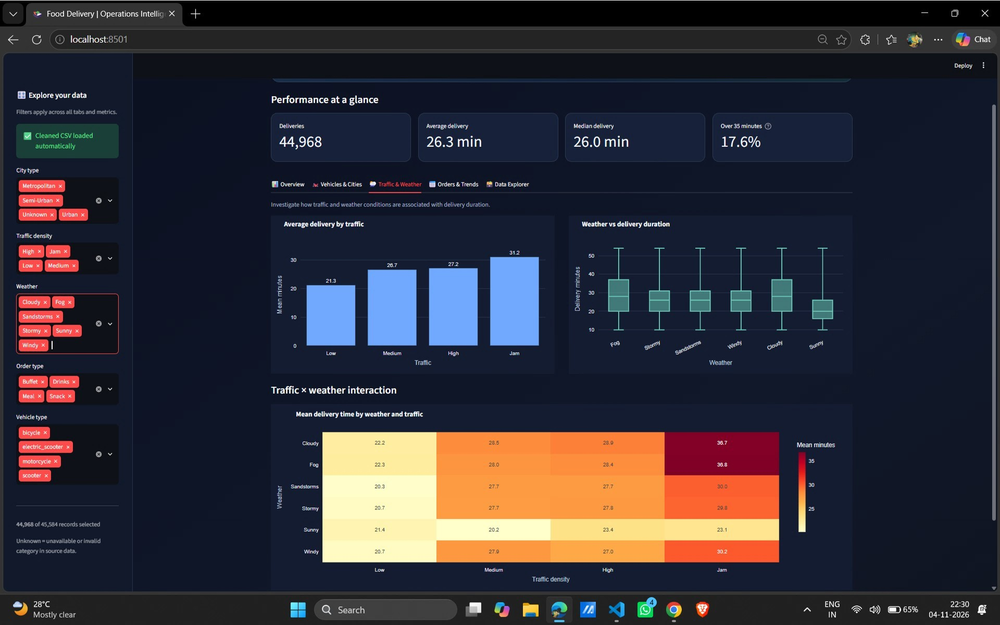
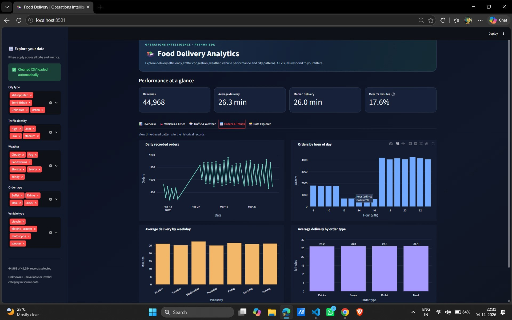
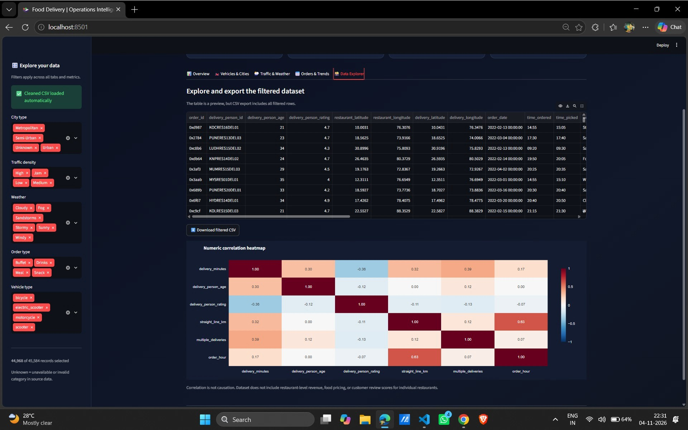
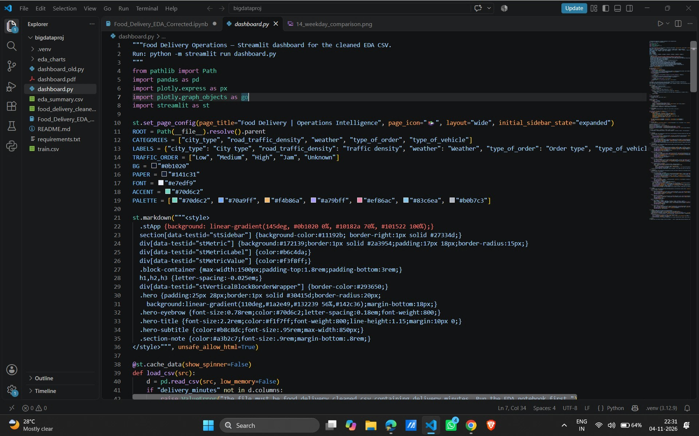

# Project screenshots

These seven original screenshots were reconstructed from the image strips embedded on each page of `photos.pdf`. They document an earlier project session, so some displayed filters and counts differ from the complete dataset. The performance classification and map were added later and are not shown here.

## 1. Notebook and dataset inspection

The EDA notebook in VS Code, showing project scope, setup, and the raw dataset shape.

## 2. Dashboard overview

The dashboard overview with sidebar filters, delivery metrics, the duration distribution, and order category shares.

## 3. Vehicles and city types

Comparisons of vehicle delivery durations, city type counts and averages, and sampled distance versus delivery time.

## 4. Traffic and weather

Delivery duration comparisons and a combined weather-traffic heatmap. The screenshot shows a filtered selection of 44,968 records.

## 5. Orders and trends

Historical daily orders, order hours, average duration by weekday, and order category comparisons for the selected records.

## 6. Data explorer

The dataset preview, filtered CSV export control, and numeric correlation heatmap.

## 7. Dashboard implementation

The Python dashboard source in VS Code, including the shared style and layout configuration.

