# Output charts

These 15 PNG files are the saved outputs supplied with the project. Run the EDA notebook from the repository root to regenerate them.

## 1. Delivery time distribution

Histogram of delivery durations in minutes, showing the spread and most common delivery times.

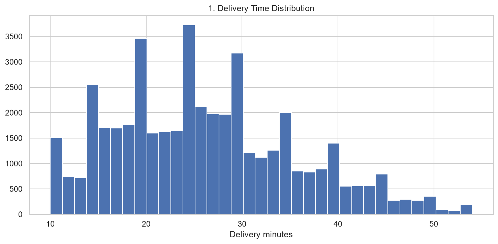

## 2. Delivery duration bands

Counts in the notebook duration bands: 20 minutes or less, 21-35, 36-60, and over 60 minutes.

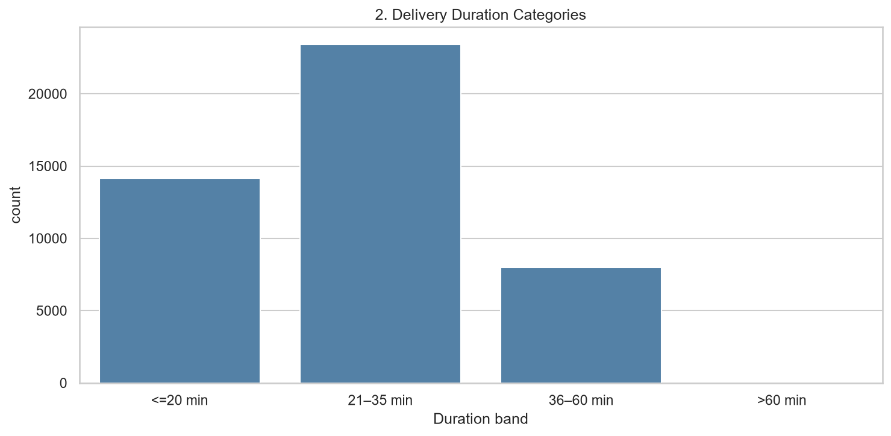

## 3. Order categories

Number of recorded orders in each food category. This describes the dataset composition.

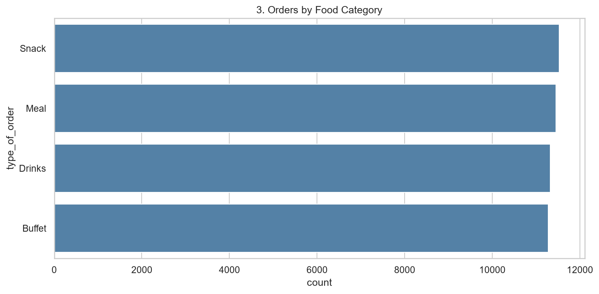

## 4. Traffic and delivery duration

Mean delivery minutes for each traffic category. Jam records average 31.18 minutes, compared with 21.27 minutes for Low traffic.

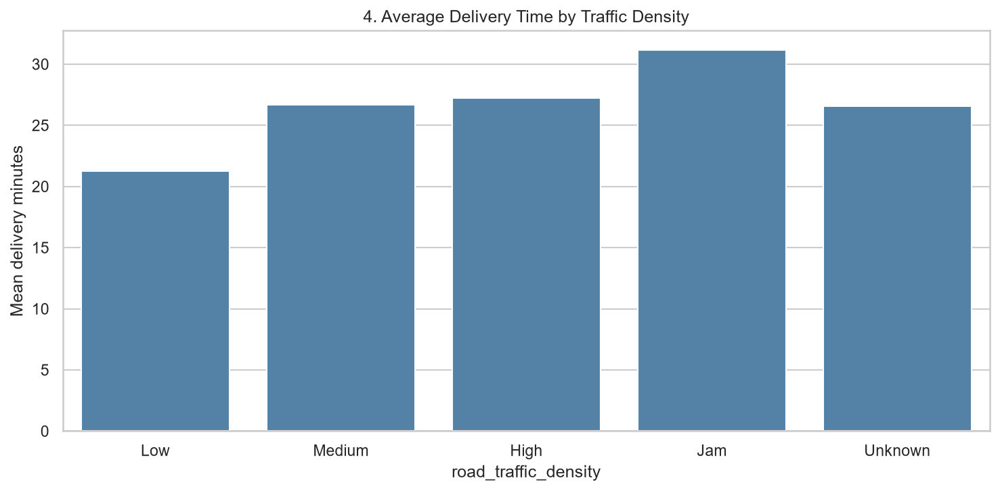

## 5. Weather and delivery duration

Boxplots compare median delivery duration and spread by weather condition; outlier points are hidden.

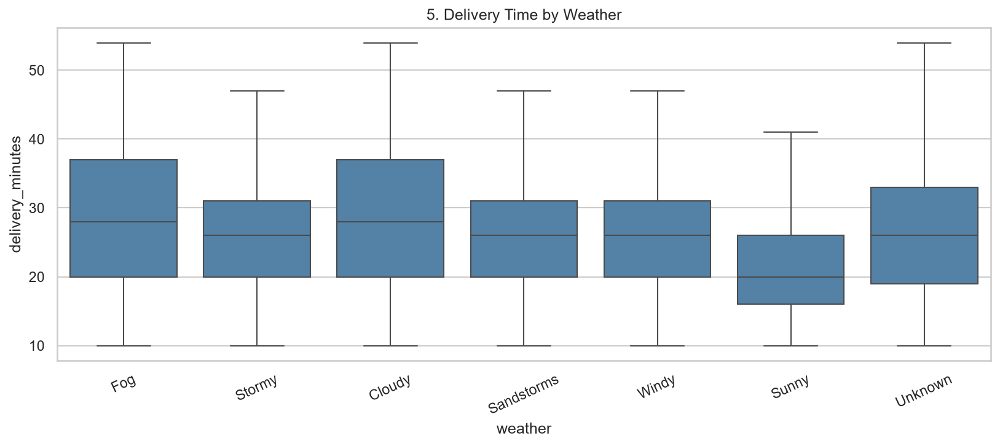

## 6. Vehicle performance

Mean delivery duration by vehicle type. Differences may also reflect route length, traffic, and vehicle assignment.

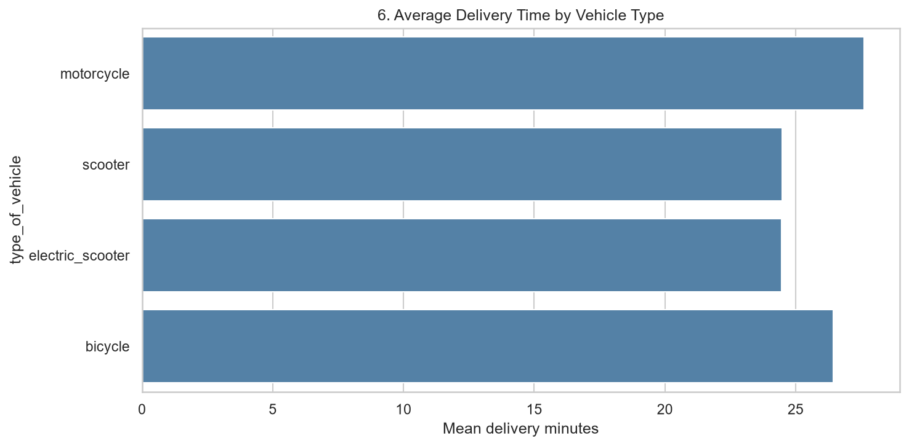

## 7. City type distribution

Number of delivery records by city classification, rather than by individual city or restaurant.

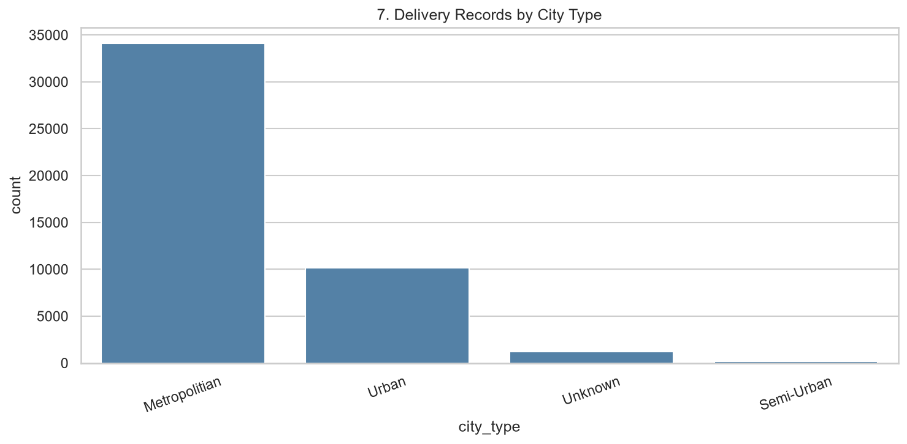

## 8. Daily recorded orders

Historical order counts by date. Missing dates are not automatically evidence of zero demand.

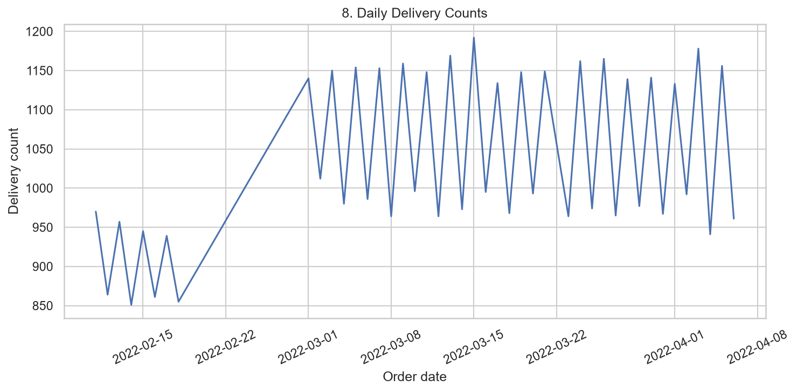

## 9. Orders by hour

Recorded order counts by hour of day, excluding records whose order times could not be parsed.

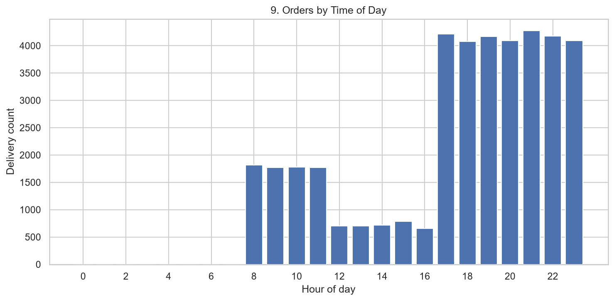

## 10. Duration by order category

Mean delivery minutes for each order category, useful for comparing descriptive category averages.

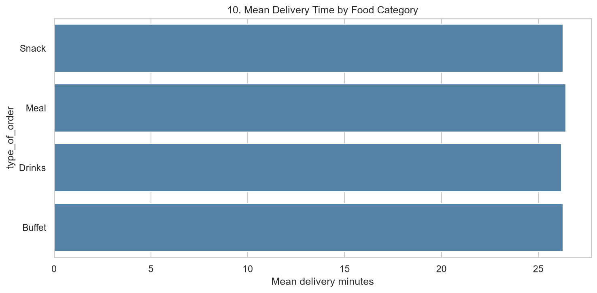

## 11. Weather and traffic together

Heatmap of mean delivery minutes for weather-traffic combinations. Group sizes can differ.

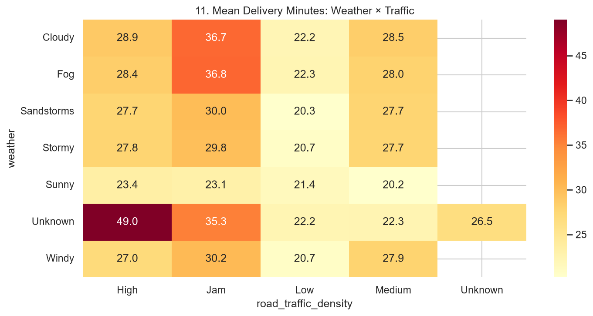

## 12. Courier ratings and delivery time

Scatter plot of up to 4,000 complete records, sampled with random_state=42. Ratings refer to couriers.

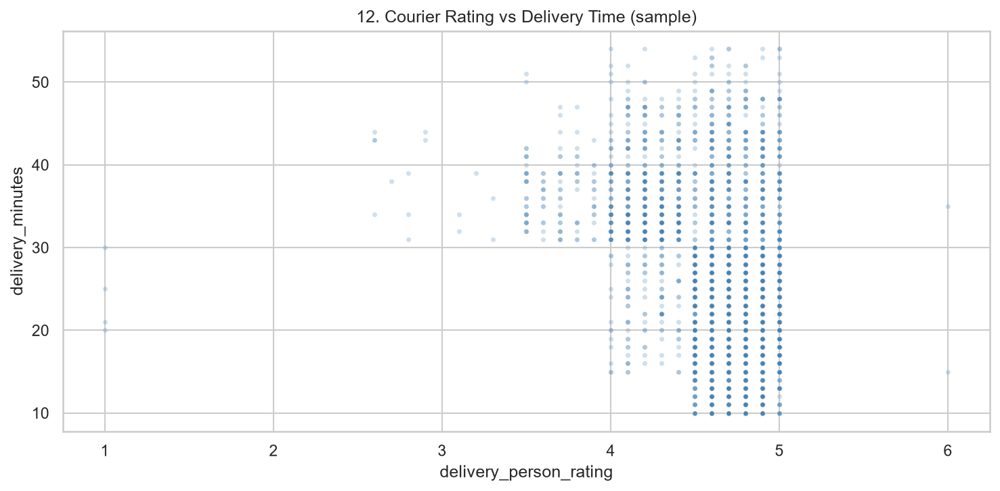

## 13. Distance and delivery time

Scatter plot of up to 5,000 complete records, sampled with random_state=42. Haversine distance approximates straight-line distance.

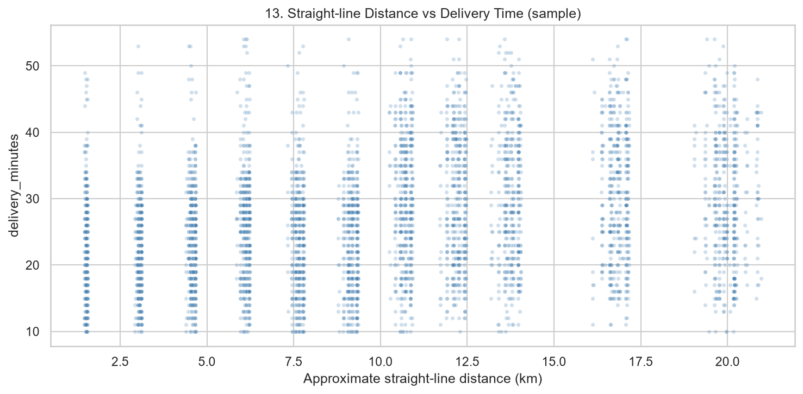

## 14. Weekday comparison

Mean delivery duration from Monday through Sunday across the available historical records.

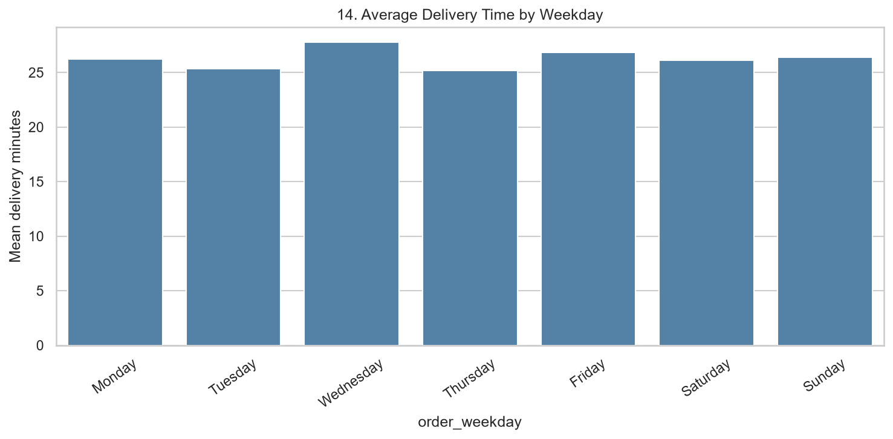

## 15. Numeric correlations

Pearson correlations between delivery duration and numeric features. Correlation does not establish causation.

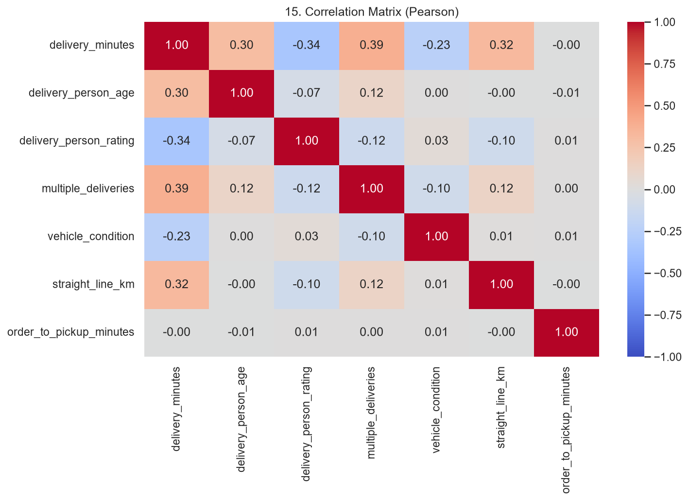
